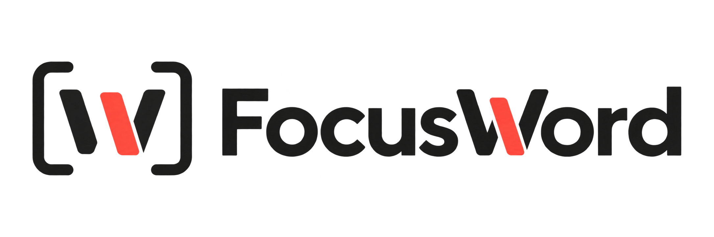
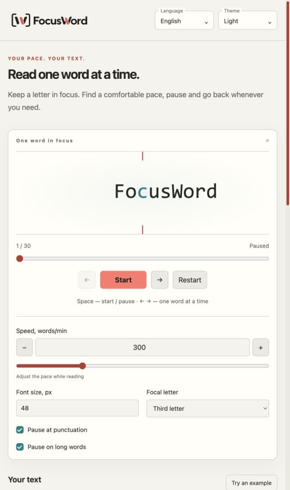

# FocusWord

[English](README.md) · [Русский](README.ru.md) · [Español](README.es.md)




Un lector sencillo que muestra una palabra a la vez. Pega un texto, elige tu ritmo y mantén la letra resaltada en foco.



## Lectura

- Velocidad de 60–1000 palabras/min, ajustable durante la reproducción.
- Inicio, pausa, repetición, navegación por palabras y progreso. Espacio inicia/pausa; las flechas avanzan una palabra.
- Tamaño de letra, tercera letra o enfoque adaptativo, pausas opcionales para puntuación y palabras largas.
- Inglés, español y ruso; menús personalizados de idioma y tema, tema del sistema, diseño adaptable y soporte de reduced-motion.
- PWA, favicon e iconos maskable; archivos de la aplicación disponibles sin conexión tras cargar la compilación de producción en línea. La instalación depende del navegador.

## Desarrollo local

Requiere Node.js 24+ y npm. Sin framework, servidor de aplicación, base de datos ni Docker.

```sh
make            # instalar si hace falta, iniciar y abrir el navegador
make start      # igual que make
make init       # instalar sin iniciar
make dev        # comprobar dependencias, iniciar y abrir el navegador
make check      # TypeScript, pruebas y formato
make build      # HTML, JavaScript, CSS y PWA estáticos → dist/
make preview    # comprobar la compilación localmente
make format     # aplicar Prettier
make screenshot # compilar y actualizar docs/images/app.png (Chrome local)
```

El lanzador instala desde el lockfile cuando faltan dependencias o cambia la huella de instalación. Comprueba las versiones de las dependencias directas en cada inicio. El primer inicio crea la huella; los siguientes reutilizan la instalación. Se necesitan Node.js 24+, npm y GNU Make en PATH, también en Windows. Usa npm.cmd en Windows y npm en macOS/Linux. Sin Make: `npm start` o `npm run dev`. Vite abre el navegador; sin entorno gráfico, abre la URL indicada manualmente. La ejecución en Windows no se ha verificado localmente.

Define `CHROME_BIN` si Chrome/Chromium está instalado en otra ruta. La tarea usa un perfil temporal, un ejemplo en inglés y un servidor local. Las herramientas de captura no son necesarias para compilar normalmente.

## Estructura

- `src/reader.ts`: reproducción e intervalos, sin dependencia del DOM.
- `src/main.ts`: controles y presentación del lector.
- `src/ui.ts` / `src/locales.ts`: interfaz y traducciones.
- `src/types/`: tipos e interfaces compartidos; importados con `import type`.
- `src/pwa.ts` / `scripts/build-pwa.mjs`: instalación y caché sin conexión.
- `public/`: única copia fuente del logotipo, iconos, manifiesto y licencia servida.
- `tests/`: pruebas Node de reproducción, iconos y caché.

El código fuente es TypeScript. `dist/` contiene JavaScript compilado y archivos estáticos; no lo edites manualmente. Es una aplicación estática, no un sistema distribuido.

## Privacidad

El texto permanece en la pestaña: la aplicación no lo envía a un servidor ni lo guarda en localStorage. No incluye analítica ni scripts de seguimiento. Solo guarda el idioma y el tema localmente; el service worker almacena archivos de la aplicación, no el texto. El alojamiento puede conservar registros de acceso. Los enlaces externos abren otros sitios; las insignias del README provienen de Shields.io y no forman parte de la aplicación.

## Notas

El lector no promete mejorar la velocidad, comprensión ni memoria. [PWA](docs/PWA.md) · [Verificación](docs/VERIFICATION.md) · [Contexto](docs/CONTEXT.md)

## Licencia

Lee las condiciones completas en [LICENSE](LICENSE). Ese archivo tiene prioridad; el README no sustituye ni simplifica sus condiciones.

[](LICENSE)
